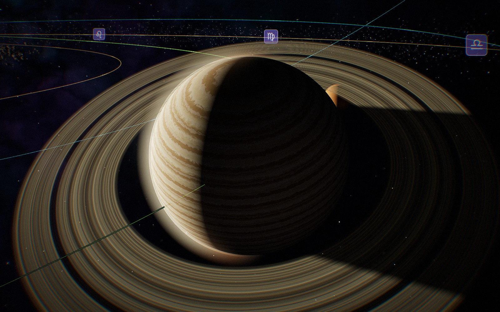
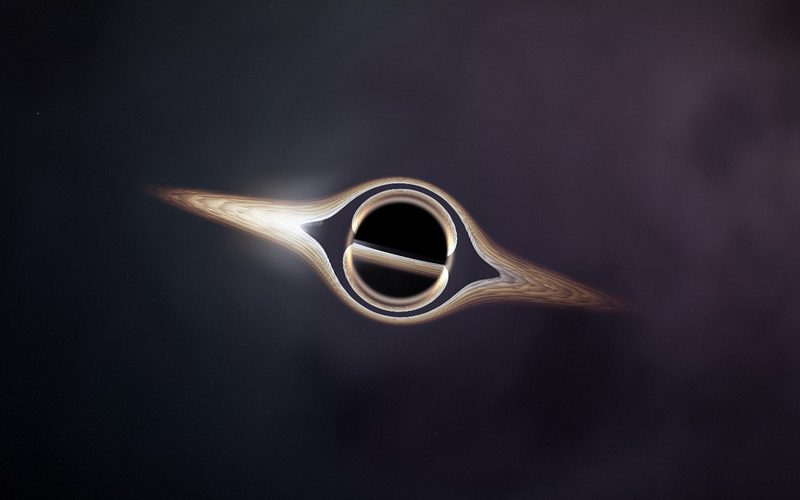
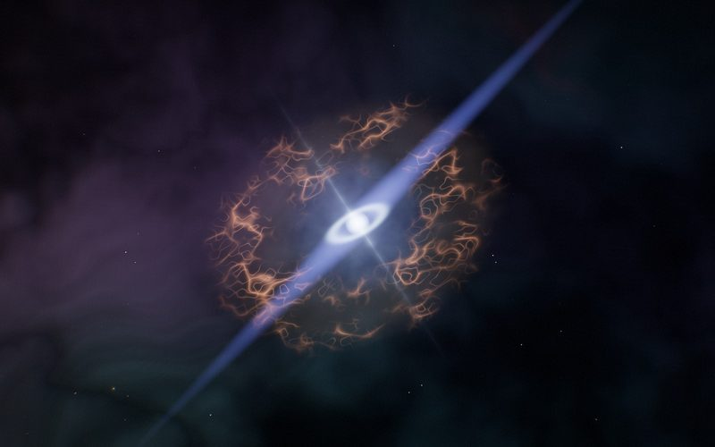
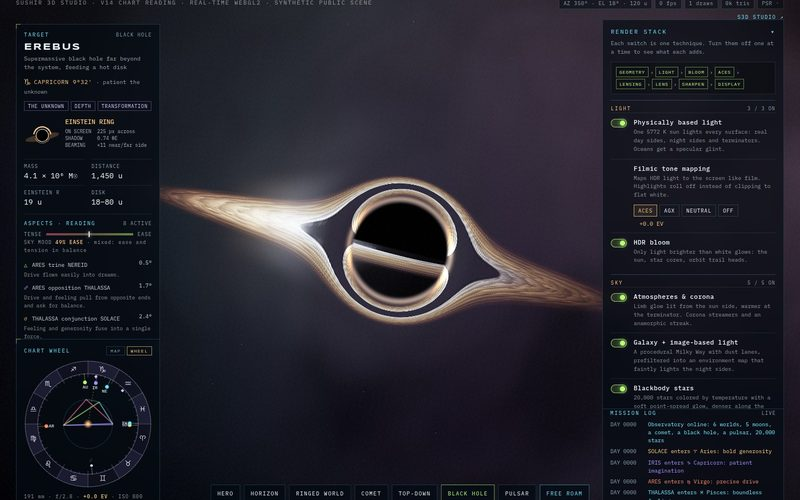
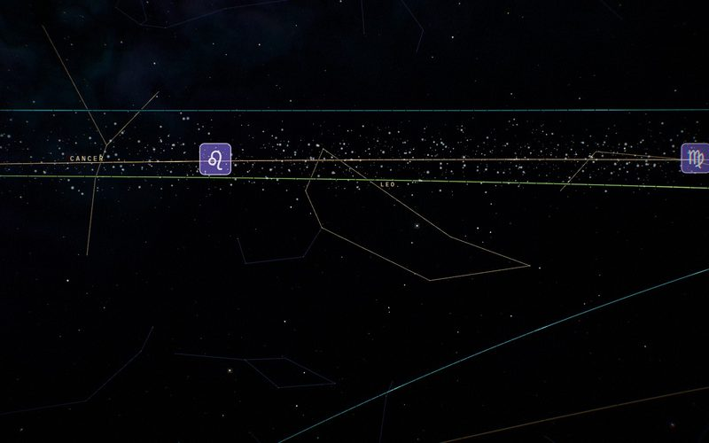
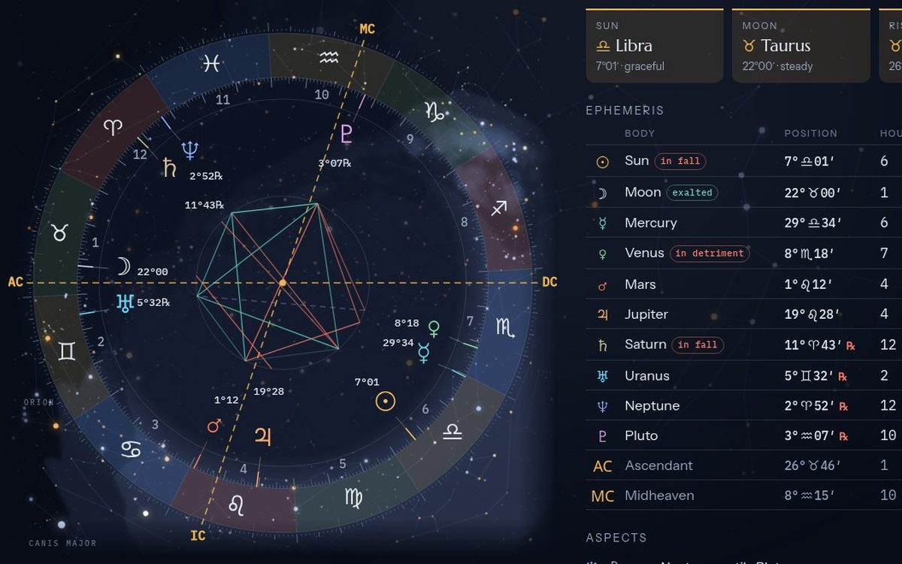
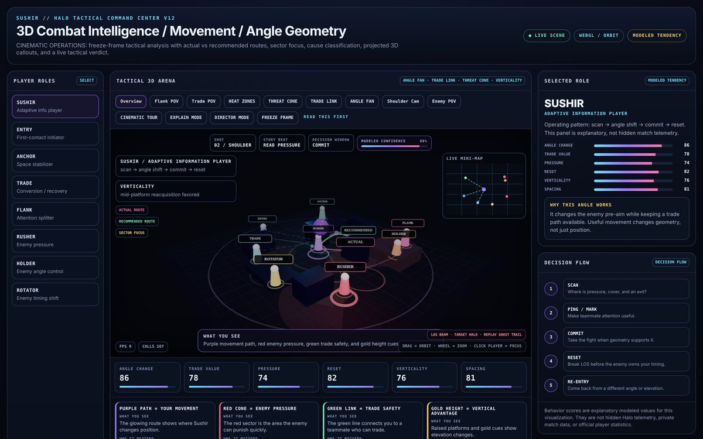
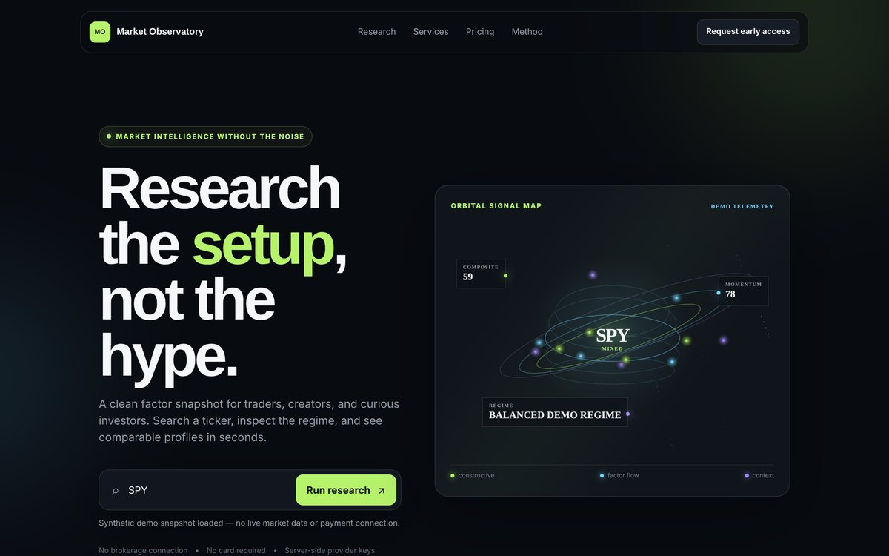
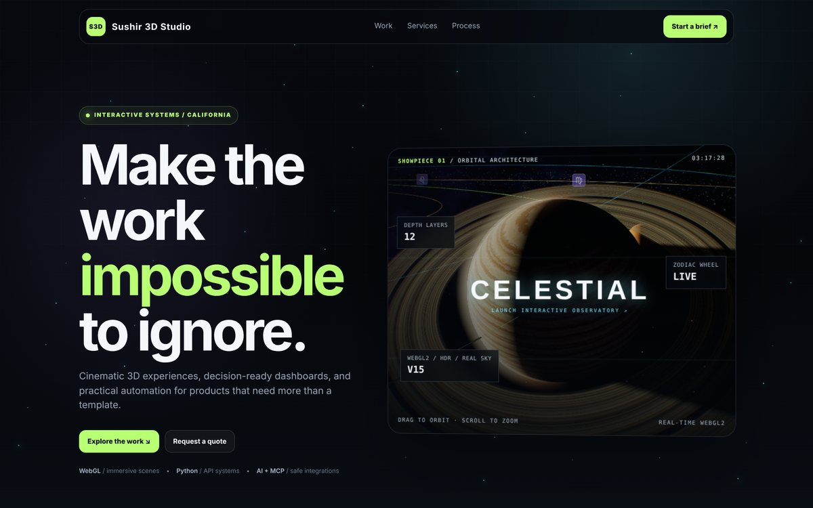

<div align="center">

<a href="https://raw.githack.com/windingsky9-droid/Ssushhii/main/portfolio/index.html"></a>

<br>

<a href="https://raw.githack.com/windingsky9-droid/Ssushhii/main/portfolio/index.html"><b>▶ Open the studio site</b></a>
&nbsp;·&nbsp; <a href="#the-work">The work</a>
&nbsp;·&nbsp; <a href="#jump-straight-in">Live demos</a>
&nbsp;·&nbsp; <a href="#hire-the-studio">Services</a>
&nbsp;·&nbsp; <a href="#run-it-locally">Run it</a>
&nbsp;·&nbsp; <a href="#repo-map">Repo map</a>

<br><br>

<a href="https://github.com/windingsky9-droid/Ssushhii/actions/workflows/ci.yml"></a>


</div>

<br>

Real-time 3D you can fly through, astronomy tools checked against a reference ephemeris, a tactical replay system, and a Flask research app with its credentials kept on the server. Everything below runs in a browser, and every image links to the live version.

## The work

<a href="https://raw.githack.com/windingsky9-droid/Ssushhii/main/portfolio/demos/celestial-observatory-cinematic.html?tour"></a>

### Celestial Observatory V15: a real-time solar system that reads the sky

One 5772 K blackbody sun lights physically shaded procedural planets, a Keplerian comet, five moons, a pulsar and a black hole whose lens pass bends the accretion disk over its own shadow. HDR bloom, ACES tone mapping and image-based light sit on top. V14 reads the sky as a chart: every body shows its zodiac sign and degree, ingresses are logged as they happen, and a chart wheel draws the aspect web around the camera. V15 puts the real sky behind it: 3,232 catalogue stars to magnitude 5.6 and all 88 constellation figures, set on the ecliptic so the zodiac constellations line up with the sign tiles.

**[▶ Launch the director tour](https://raw.githack.com/windingsky9-droid/Ssushhii/main/portfolio/demos/celestial-observatory-cinematic.html?tour)** · [Free roam](https://raw.githack.com/windingsky9-droid/Ssushhii/main/portfolio/demos/celestial-observatory-cinematic.html) · [Source](portfolio/demos/celestial-observatory-cinematic.html) · [The 19 techniques behind it](portfolio/RENDERING_PLAYBOOK.md)

<table>
<tr>
<td width="25%" align="center"><a href="https://raw.githack.com/windingsky9-droid/Ssushhii/main/portfolio/demos/celestial-observatory-cinematic.html?shot=erebus"></a><br><sub><b>Black hole</b> · lensed disk</sub></td>
<td width="25%" align="center"><a href="https://raw.githack.com/windingsky9-droid/Ssushhii/main/portfolio/demos/celestial-observatory-cinematic.html?shot=pulsar"></a><br><sub><b>Pulsar</b> · sweeping beams</sub></td>
<td width="25%" align="center"><a href="https://raw.githack.com/windingsky9-droid/Ssushhii/main/portfolio/demos/celestial-observatory-cinematic.html?wheel&shot=ringed"></a><br><sub><b>Chart wheel</b> · live aspects</sub></td>
<td width="25%" align="center"><a href="https://raw.githack.com/windingsky9-droid/Ssushhii/main/portfolio/demos/celestial-observatory-cinematic.html?shot=sky"></a><br><sub><b>Real sky</b> · Leo behind ♌︎</sub></td>
</tr>
</table>

<table>
<tr>
<td width="50%" valign="top">
<a href="https://raw.githack.com/windingsky9-droid/Ssushhii/main/portfolio/demos/sky-wheel.html"></a>
<h3>Sky Wheel</h3>
The real Sun, Moon and planets for any moment from 1800 to 2050: signs, houses, aspects, retrogrades, the Moon's phase and the next 45 days of sign changes. Checked against PyEphem at 240 dates: the largest error is 0.21°, and the Moon stays within 0.08°. Saves a 2400×3200 print poster, and nothing you enter leaves the page.
<br><br>
<a href="https://raw.githack.com/windingsky9-droid/Ssushhii/main/portfolio/demos/sky-wheel.html"><b>▶ Open it</b></a> · <a href="https://raw.githack.com/windingsky9-droid/Ssushhii/main/portfolio/demos/sky-wheel.html?cmp=1&d=1969-07-20T15:17&tz=America/Chicago&place=Houston&n1=Moon%20landing&n2=Today">Moon landing vs. today</a> · <a href="portfolio/demos/sky-wheel.html">Source</a>
</td>
<td width="50%" valign="top">
<a href="https://raw.githack.com/windingsky9-droid/Ssushhii/main/showcase/SUSHIR_HALO_TACTICAL_COMMAND_CENTER_V12_CINEMATIC_OPERATIONS.html"></a>
<h3>Halo Tactical Command Center V12</h3>
A Three.js arena that replays a fight and explains it: actual vs. recommended 3D routes, freeze-frame analysis, cause classification, sector focus, a live mini-map and a tactical verdict for every commit, hold or reset. Director Mode adds a LOS beam, target halo and replay ghosts.
<br><br>
<a href="https://raw.githack.com/windingsky9-droid/Ssushhii/main/showcase/SUSHIR_HALO_TACTICAL_COMMAND_CENTER_V12_CINEMATIC_OPERATIONS.html"><b>▶ Open it</b></a> · <a href="https://raw.githack.com/windingsky9-droid/Ssushhii/main/showcase/SUSHIR_HALO_TACTICAL_COMMAND_CENTER_V12_CINEMATIC_OPERATIONS.html?director=1">Director Mode</a> · <a href="showcase/">All builds, V6 → V12</a>
</td>
</tr>
<tr>
<td width="50%" valign="top">
<a href="https://raw.githack.com/windingsky9-droid/Ssushhii/main/public-demo/index.html"></a>
<h3>Market Observatory</h3>
The Flask app in this repo: a ticker research dashboard with a composite profile, factor lens, market context and comparable symbols. It runs on deterministic demo data with no account, and switches to a live provider only when a server-side key is set. Paid buttons stay off until you add your own Stripe Payment Links.
<br><br>
<a href="https://raw.githack.com/windingsky9-droid/Ssushhii/main/public-demo/index.html"><b>▶ Open the demo</b></a> · <a href="#run-it-locally">Run it locally</a> · <a href="app.py">Source</a>
</td>
<td width="50%" valign="top">
<a href="https://raw.githack.com/windingsky9-droid/Ssushhii/main/portfolio/index.html"></a>
<h3>Sushir 3D Studio site</h3>
The buyer-facing portfolio: hero, selected work, scoped services, process and a contact card that routes briefs to a GitHub issue template. Static HTML that runs from any file host, with a shop and a support section that switch on only when you add your own checkout links.
<br><br>
<a href="https://raw.githack.com/windingsky9-droid/Ssushhii/main/portfolio/index.html"><b>▶ Open it</b></a> · <a href="portfolio/README.md">How it works</a> · <a href="portfolio/index.html">Source</a>
</td>
</tr>
</table>

<details>
<summary><b>Also shipped: Cargo Profit Engine</b>, a live technical-pilot funnel</summary>
<br>

A separate public funnel that showcases the lead-intelligence and developer-service workflow built around Cargo + Go + Sitelas + Quickchat.

- **Live site:** https://cargo-profit-engine-5820.sitelas.com
- **Tracked launch link:** https://zipgo.ink/cargo-profit-engine
- **AI customer guide:** https://app.quickchat.ai/ri4k73zpat
- **Current verified build:** 8 scored accounts, 3 P1 opportunities, 3 relevant professional buyers found, 0 outbound messages sent during the build.
- **Developer-service focus:** API integrations, workflow automation, Go/Flask dashboards, testing/CI, and bounded AI/MCP prototypes.
- **Public/private separation:** public pages show anonymized opportunity categories; exact prospect and buyer identities remain private.
- **Activation controls:** enrichment and outbound are gated until relevance, suppression, basis, and sender-readiness checks are documented.

The funnel is designed to turn traffic into technical questions or pilot requests, not to claim guaranteed revenue or ROI.

</details>

<details>
<summary><b>Everything in the Halo Tactical Command Center</b></summary>
<br>

- actual vs. recommended 3D routes
- freeze-frame tactical analysis
- cause classification for repeated tactical mistakes
- sector focus showing where pressure matters
- projected 3D callouts attached to the arena
- a story timeline from read → contact → decision → conversion → reset
- a live tactical verdict explaining commit / hold / reset / change-angle decisions
- full-screen Director Mode with LOS beam, target halo, replay ghosts, story beat, decision window and modeled confidence
- synchronized replay controls, cover-aware LOS checks, modeled target priority, objective overlays and a matchup matrix
- a live mini-map and render telemetry
- explicit separation of modeled tactical values from real or official Halo telemetry

Low-key version: **I made the angles move, then made them explain themselves.**

Earlier builds: [V6](showcase/SUSHIR_HALO_TACTICAL_COMMAND_CENTER_V6.html) · [V8 Clarity](showcase/SUSHIR_HALO_TACTICAL_COMMAND_CENTER_V8_CLARITY.html) · [V9 Showpiece](showcase/SUSHIR_HALO_TACTICAL_COMMAND_CENTER_V9_SHOWPIECE.html) · [V11 Director Cut](showcase/SUSHIR_HALO_TACTICAL_COMMAND_CENTER_V11_DIRECTOR_CUT.html)

</details>

## Jump straight in

Every link opens the live demo in a specific mode. A desktop browser gives the best frame rate.

| Open | What you get |
|---|---|
| [Director tour](https://raw.githack.com/windingsky9-droid/Ssushhii/main/portfolio/demos/celestial-observatory-cinematic.html?tour) | A narrated camera flight through the whole observatory |
| [Chart wheel](https://raw.githack.com/windingsky9-droid/Ssushhii/main/portfolio/demos/celestial-observatory-cinematic.html?wheel&shot=ringed) | The ringed world with the aspect wheel drawn around the camera |
| [Black hole](https://raw.githack.com/windingsky9-droid/Ssushhii/main/portfolio/demos/celestial-observatory-cinematic.html?shot=erebus) | The lens pass bending the disk into an Einstein ring |
| [Pulsar](https://raw.githack.com/windingsky9-droid/Ssushhii/main/portfolio/demos/celestial-observatory-cinematic.html?shot=pulsar) | Beams sweeping through a nebula |
| [Real sky](https://raw.githack.com/windingsky9-droid/Ssushhii/main/portfolio/demos/celestial-observatory-cinematic.html?shot=sky) | Leo and Cancer from catalogue stars, behind the ♌︎ tile |
| [Compare split](https://raw.githack.com/windingsky9-droid/Ssushhii/main/portfolio/demos/celestial-observatory-cinematic.html?compare) | Flat render on one side, the full render stack on the other |
| [Clean view](https://raw.githack.com/windingsky9-droid/Ssushhii/main/portfolio/demos/celestial-observatory-cinematic.html?ui=clean) | No HUD, just the render |
| [Cool mode](https://raw.githack.com/windingsky9-droid/Ssushhii/main/portfolio/demos/celestial-observatory-cinematic.html?fps=30) | A 30 fps cap so laptops stay quiet |
| [Moon landing vs. today](https://raw.githack.com/windingsky9-droid/Ssushhii/main/portfolio/demos/sky-wheel.html?cmp=1&d=1969-07-20T15:17&tz=America/Chicago&place=Houston&n1=Moon%20landing&n2=Today) | Sky Wheel Compare: two moments, one ring inside the other |
| [Halo V12 Director Mode](https://raw.githack.com/windingsky9-droid/Ssushhii/main/showcase/SUSHIR_HALO_TACTICAL_COMMAND_CENTER_V12_CINEMATIC_OPERATIONS.html?director=1) | The full-screen tactical replay |
| [Market Observatory demo](https://raw.githack.com/windingsky9-droid/Ssushhii/main/public-demo/index.html) | The research dashboard on synthetic data |
| [Lightweight 2D preview](https://raw.githack.com/windingsky9-droid/Ssushhii/main/portfolio/demos/celestial-observatory-public.html) | The observatory for slower devices |

## Hire the studio

| Offer | What you get | Price |
|---|---|---|
| **One Flask/API fix** | One agreed issue in an existing Flask app or REST endpoint: the code change, a verification check and a short handoff. [Details and one-page PDF](docs/services/flask-api-fix.md) | **$40** |
| **API integrations** | A documented REST API connected to a Python app with safe configuration, error handling and tests. | from $15 |
| **Dashboards & tools** | A responsive internal tool with loading states, provider boundaries, a health endpoint and a clean handoff. | from $25 |
| **3D / AI systems** | An interactive WebGL showpiece, or an AI/MCP workflow wired up without leaking credentials. | scoped first |

**[Open a service brief →](https://github.com/windingsky9-droid/Ssushhii/issues/new?template=service-request.yml)** Include the expected behavior, the error, your stack and the relevant documentation. Scope and timing are confirmed before you pay. GitHub issues are public, so keep passwords, API keys and private customer data out of them.

## Run it locally

Everything costs $0 to run. The Market Observatory loads a SPY demo snapshot with no account and no API key.

**Windows (PowerShell)**

```powershell
py -m venv .venv
.\.venv\Scripts\python.exe -m pip install -r requirements.txt
.\.venv\Scripts\python.exe app.py
```

**macOS / Linux**

```bash
python3 -m venv .venv
.venv/bin/pip install -r requirements.txt
.venv/bin/python app.py
```

Open `http://127.0.0.1:5000`. To preview the studio site and its demos instead, run `python scripts/serve_portfolio.py --open` (it serves `portfolio/` at `http://127.0.0.1:4173`).

**Test and verify**

```bash
python -m pytest -q
python -m compileall app.py src
python scripts/check_portfolio.py
```

The test suite also checks that every page starts with its doctype and that every link and image in this README resolves.

<details>
<summary><b>Market Observatory: live data, payments and deployment</b></summary>
<br>

**Why it exists.** It tests whether people will use and pay for a clearer research workflow before any money goes into infrastructure. It is a research product, not an auto-trader and not a promise of investment returns.

**What's in the MVP**

- A responsive ticker-research dashboard.
- Deterministic demo mode with no account or API key required.
- An optional Factor Weave REST provider on the server.
- Composite profile, factor lens, market context and comparable symbols.
- Free / Pro / Creator pricing presentation.
- Paid buttons stay disabled until Stripe Payment Links are deliberately configured.
- Health and JSON research endpoints (`/health`, `/api/config`, `/api/research?ticker=SPY`) for deployment checks.

**Optional live Factor Weave mode**

1. Copy `.env.example` to `.env`.
2. Put a Factor Weave API key in `FACTORWEAVE_API_KEY`.
3. Load that environment before starting the app.
4. Keep `.env` local; it is ignored by Git.

The browser never receives the Factor Weave credential. Provider requests are made by Flask on the server.

**Optional payments.** Create hosted Stripe Payment Links only when you intentionally want to accept payments, then set `STRIPE_PRO_URL` and/or `STRIPE_CREATOR_URL`. Until those variables are present, the paid buttons remain disabled. The app does not collect card data or need a Stripe secret key. See [`docs/REVENUE_SETUP.md`](docs/REVENUE_SETUP.md) for the end-to-end proof, live-provider, checkout and first-revenue flow.

**Hosted deployment.** The repository includes a production entry point (`wsgi.py`), a `Procfile` and a Dockerfile. Hosts that support Procfiles can use:

```text
gunicorn --bind 0.0.0.0:$PORT --workers 2 --threads 4 --timeout 60 wsgi:app
```

For Docker-based hosting:

```bash
docker build -t market-observatory .
docker run --rm -p 5000:5000 --env-file .env market-observatory
```

Keep `FACTORWEAVE_API_KEY`, `STRIPE_PRO_URL` and `STRIPE_CREATOR_URL` in the host's secret or environment settings. Never bake `.env` into an image or commit it.

</details>

## Repo map

```text
.
├── app.py, wsgi.py      Market Observatory (Flask) and its production entry point
├── src/                 research providers, pricing and the Factor Weave client
├── templates/, static/  the dashboard UI
├── public-demo/         static build of the dashboard on synthetic data
├── portfolio/           Sushir 3D Studio site, live demos, stills and the rendering playbook
├── showcase/            Halo Tactical Command Center builds, V6 → V12
├── docs/                service sheet, launch kits and revenue setup
├── scripts/             portfolio server, link checker and demo builder
├── tests/               the pytest suite, run in CI on every push and pull request
└── .github/             CI workflow, issue templates and the images in this README
```

<br>

<div align="center">
<sub>Research and market visuals are illustrative, not investment advice. Halo showcase values are modeled demo data, not official telemetry; Halo is a Microsoft trademark and this project is not affiliated with or endorsed by Microsoft. Star, constellation and Milky Way data from d3-celestial, © 2015 Olaf Frohn, BSD 3-Clause. Live demos are served from this repository through <a href="https://raw.githack.com">raw.githack</a>.</sub>
</div>
