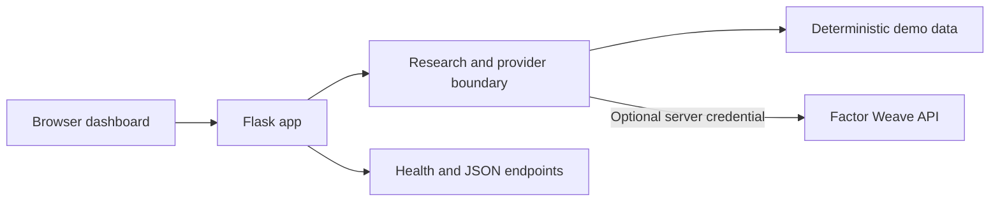

<div align="center">

# Market Observatory

**A calmer way to turn a ticker into a structured research brief.**

Start instantly with deterministic demo data. Connect the optional Factor Weave provider when you are ready. The app presents context for human research; it does not trade or promise returns.

[Run locally](#run-locally) · [Explore the product](#what-you-can-explore) · [Read the docs](#project-guides) · [Request a small API fix](#work-with-the-project)


[](https://github.com/windingsky9-droid/Ssushhii/actions/workflows/ci.yml)
[](https://github.com/windingsky9-droid/Ssushhii/issues)

</div>

---

## The idea

Market Observatory is a small, deployable research dashboard built around a clear provider boundary. It gives a visitor a useful first look without an account, paid data plan, or API key. When a Factor Weave key is configured on the server, research can use that provider instead.

The experience is intended to make a research session easier to scan: a composite profile, factor lens, market context, and comparable symbols in one place.

> **Research support, not financial advice.** The app is not an auto-trader, does not execute transactions, and does not guarantee investment outcomes. Demo data is illustrative.

## What you can explore

| Area | What it does |
| --- | --- |
| Research dashboard | Responsive ticker view with a SPY demo snapshot ready on first launch |
| Provider boundary | Deterministic demo mode works without credentials; optional Factor Weave requests stay server-side |
| Research summary | Composite profile, factor lens, market context, and comparable symbols |
| Pricing presentation | Free, Pro, and Creator tiers; paid actions stay inactive until payment links are configured |
| Operational endpoints | Health and JSON research endpoints for deployment checks |
| Visual experiments | A separate 3D portfolio and tactical showcase, linked below |

### A look at the system



The browser does not receive the Factor Weave credential. Configure secrets in the local environment or your hosting provider.

## Run locally

The $0 path starts in demo mode and needs no API key.

```powershell
py -m venv .venv
.\.venv\Scripts\python.exe -m pip install -r requirements.txt
.\.venv\Scripts\python.exe app.py
```

Open [http://127.0.0.1:5000](http://127.0.0.1:5000). A SPY demo snapshot is loaded automatically.

### Optional: connect Factor Weave

1. Copy `.env.example` to `.env`.
2. Set `FACTORWEAVE_API_KEY` in `.env`.
3. Load the environment and start the app.

Keep `.env` out of Git. The browser never needs this key.

### Optional: enable hosted checkout links

Set `STRIPE_PRO_URL` and/or `STRIPE_CREATOR_URL` to hosted Stripe Payment Links only when you intend to accept payments. Until those variables are configured, paid buttons remain disabled. This project does not collect card details or require a Stripe secret key.

See [Revenue setup](docs/REVENUE_SETUP.md) for the proof, live-provider, checkout, and first-revenue flow.

## Verify changes

```powershell
.\.venv\Scripts\python.exe -m pytest -q
.\.venv\Scripts\python.exe -m compileall app.py src
```

GitHub Actions runs the same test and compile checks on pushes to `main` and pull requests.

## Deploy

The repo includes a WSGI entry point, Procfile, and Dockerfile.

**Procfile-compatible host**

```text
gunicorn --bind 0.0.0.0:$PORT --workers 2 --threads 4 --timeout 60 wsgi:app
```

**Docker**

```powershell
docker build -t market-observatory .
docker run --rm -p 5000:5000 --env-file .env market-observatory
```

Keep provider and payment-link values in your host's secret or environment settings. Do not bake `.env` into an image or commit it.

## Project guides

| Guide | Use it for |
| --- | --- |
| [Revenue setup](docs/REVENUE_SETUP.md) | Proving the demo, configuring the provider, checkout, and first-revenue steps |
| [Launch checklist](docs/LAUNCH_CHECKLIST.md) | A practical pass through launch readiness |
| [Flask/API service brief](docs/services/flask-api-fix.md) | Scope and boundaries for a small fixed-scope API fix |
| [Fiverr seller kit](docs/FIVERR_SELLER_KIT.md) | Service listing and buyer handoff materials |
| [Contributing](CONTRIBUTING.md) | Local workflow, tests, and pull-request expectations |
| [Security](SECURITY.md) | How to report a possible vulnerability |

## More from the studio

### Sushir 3D Studio

Browse the privacy-safe showcase in [portfolio/](portfolio/). Open `portfolio/index.html` locally or serve the folder from a static host. It includes a cinematic still, synthetic demo, and service positioning.

### Tactical operations showcase

[Open Sushir Halo Tactical Command Center V12 — Cinematic Operations](showcase/SUSHIR_HALO_TACTICAL_COMMAND_CENTER_V12_CINEMATIC_OPERATIONS.html).

This Three.js/WebGL demo explores route comparison, freeze-frame analysis, pressure sectors, replay controls, cover-aware line-of-sight checks, objective overlays, a live mini-map, and render telemetry. Tactical values are modeled for the demo and are not official Halo telemetry.

### Cargo Profit Engine

A separate funnel for lead-intelligence and technical-pilot work:

- [Live site](https://cargo-profit-engine-5820.sitelas.com)
- [Tracked launch link](https://zipgo.ink/cargo-profit-engine)
- [AI customer guide](https://app.quickchat.ai/ri4k73zpat)

The published summary describes 8 scored accounts, 3 P1 opportunities, 3 relevant professional buyers found, and 0 outbound messages sent during that build. Public pages use anonymized opportunity categories; exact prospect identities remain private. The funnel is intended to start technical conversations, not promise revenue or ROI.

## Work with the project

For a reproducible Flask or REST endpoint issue, the project offers **one agreed issue for $40 USD**. The scope, timing, verification, and any paid services are confirmed before work begins.

[Open the service-request form](https://github.com/windingsky9-droid/Ssushhii/issues/new?template=service-request.yml) with the expected behavior, error, relevant stack, and documentation. Keep credentials and private customer data out of public issues. [Read the service brief](docs/services/flask-api-fix.md).

---

<sub>Built as a practical research MVP: useful in demo mode, optional to connect, and explicit about what it does.</sub>
