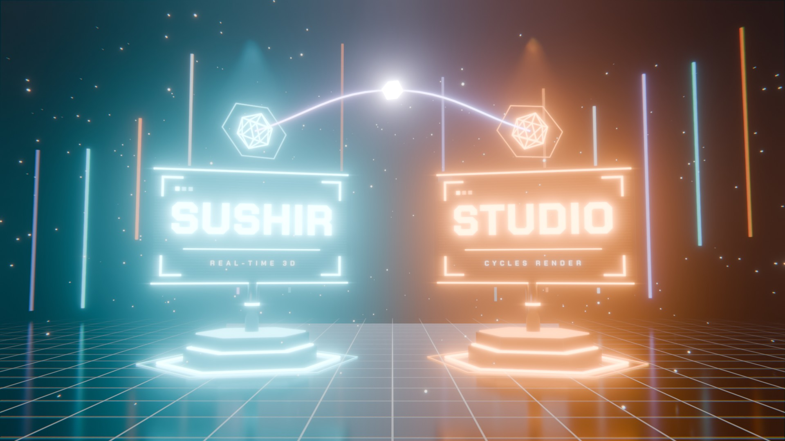
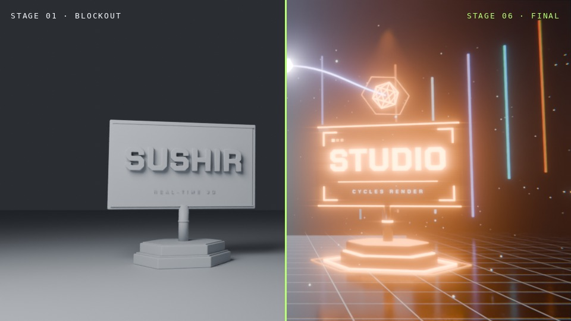
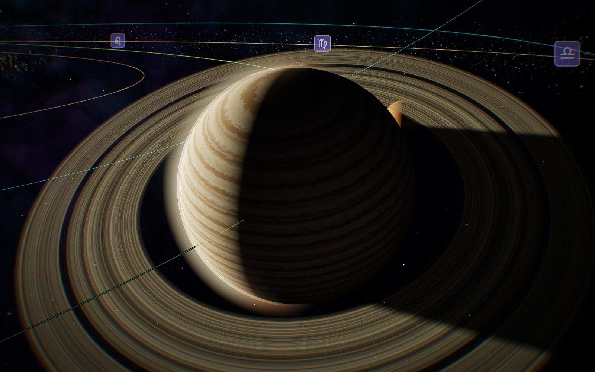
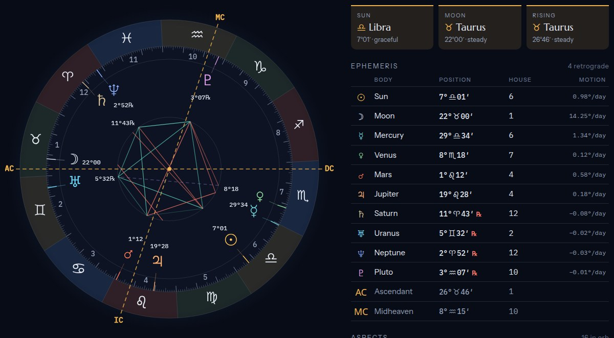
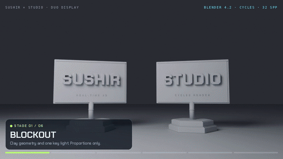
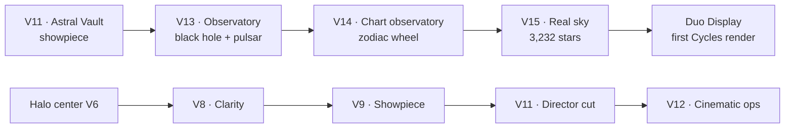
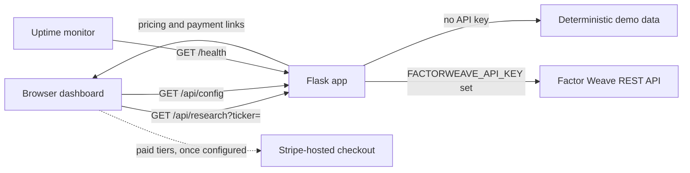

<div align="center">

<a href="blender/"></a>

# Sushir 3D Studio

**Real-time WebGL worlds, path-traced Blender renders, and the Flask tools behind them.**

[](https://github.com/windingsky9-droid/Ssushhii/actions/workflows/ci.yml)


[Blender build log](blender/) · [Portfolio](portfolio/) · [Halo command center](#interactive-3d-tactical-showcase) · [Market Observatory](#market-observatory) · [Hire me](#need-a-small-flaskapi-fix)

</div>

---

<table>
  <tr>
    <td width="33%" valign="top"><a href="blender/"></a><br><b>Duo Display</b><br><sub>Blender 4.2 · Cycles · six-stage build log</sub></td>
    <td width="33%" valign="top"><a href="portfolio/"></a><br><b>Celestial Observatory V15</b><br><sub>three.js · WebGL2 · real sky</sub></td>
    <td width="33%" valign="top"><a href="portfolio/demos/sky-wheel.html"></a><br><b>Sky Wheel</b><br><sub>Planets for any moment, 1800 to 2050</sub></td>
  </tr>
</table>

## Projects

| Project | What it is | Stack | Open |
|---|---|---|---|
| **Duo Display** | The studio's first path-traced piece. One script builds the scene and renders it, from clay blockout to graded final. | Blender 4.2, Cycles, Python | [Build log](blender/) |
| **Celestial Observatory V15** | A real-time solar system read as a live chart, set against 3,232 catalogue stars. | three.js r170, WebGL2, HDR | [Portfolio](portfolio/) |
| **Sky Wheel** | The real Sun, Moon and planets for any moment, checked against PyEphem to within 0.21°. | JavaScript, canvas | [Demo](portfolio/demos/sky-wheel.html) |
| **Halo Tactical Command Center V12** | Cinematic tactical analysis: actual vs. recommended routes, freeze frames, a live verdict. | three.js, WebGL | [Showcase](#interactive-3d-tactical-showcase) |
| **Market Observatory** | A zero-cost market research MVP with a clean provider boundary. | Python 3.13, Flask | [Run it](#run-locally-0-path) |
| **Cargo Profit Engine** | A live technical-pilot funnel for developer services. | Cargo, Go, Sitelas, Quickchat | [Live site](https://cargo-profit-engine-5820.sitelas.com) |

## New: watch a render get built

<a href="blender/"></a>

| 1 · Blockout | 2 · Materials | 3 · Lighting | 4 · Set dressing | 5 · Atmosphere | 6 · Lens + grade |
|---|---|---|---|---|---|
| Clay and one key light | Metal, glass, glowing 3D type | Coloured spots, rim and fill | HUD, cores, team-up arc | Volumetric god rays | DOF, AgX, bloom, streaks |

The earlier stills are browser captures of the WebGL demos. Duo Display is path traced: real reflections, light that scatters through haze, physical depth of field and glowing type that lights the metal around it. The [build log](blender/) has the scripts, timings, every stage, and how to render your own two names.

## How the studio grew



---

## Need a small Flask/API fix?

**$40 USD for one agreed Flask/API issue.** I can review a reproducible Flask or REST endpoint issue and confirm whether it fits the fixed price before you commit. The agreed scope includes the change, a verification check, and a short handoff; timing and any paid services are agreed first.

[Open a developer service brief](https://github.com/windingsky9-droid/Ssushhii/issues/new?template=service-request.yml) with the expected behavior, error, stack, and relevant documentation. Keep passwords, API keys, and private customer data out of public issues.

[See the service details and one-page PDF](docs/services/flask-api-fix.md).

## Market Observatory

A zero-required-cost market research MVP built around a clean provider boundary. It runs immediately with deterministic demo data and switches to server-side Factor Weave research when `FACTORWEAVE_API_KEY` is configured.



### Why this exists

The goal is to validate whether people will use and pay for a clearer research workflow before spending money on infrastructure. It is a research product, not an auto-trader and not a promise of investment returns.

### Current MVP

- Premium responsive ticker-research dashboard.
- Deterministic demo mode with no account or API key required.
- Optional Factor Weave REST provider on the server.
- Composite profile, factor lens, market context, and comparable symbols.
- Free / Pro / Creator pricing presentation.
- Paid CTAs remain disabled until Stripe Payment Links are deliberately configured.
- Health and JSON research endpoints for deployment checks.

### Run locally ($0 path)

```powershell
py -m venv .venv
.\.venv\Scripts\python.exe -m pip install -r requirements.txt
.\.venv\Scripts\python.exe app.py
```

Open `http://127.0.0.1:5000`. The app automatically loads a SPY demo snapshot.

### Optional live Factor Weave mode

1. Copy `.env.example` to `.env`.
2. Put a Factor Weave API key in `FACTORWEAVE_API_KEY`.
3. Load that environment before starting the app.
4. Keep `.env` local; it is ignored by Git.

The browser never receives the Factor Weave credential. Provider requests are made by Flask on the server.

### Optional payments

Create hosted Stripe Payment Links only when you intentionally want to accept payments, then set `STRIPE_PRO_URL` and/or `STRIPE_CREATOR_URL`. Until those variables are present, the paid buttons remain disabled. This MVP does not collect card data or require a Stripe secret key.

See [`docs/REVENUE_SETUP.md`](docs/REVENUE_SETUP.md) for the end-to-end proof, live-provider, checkout, and first-revenue flow. `.env.example` documents the supported local variables; real credentials stay in `.env` or the deployment host's secret manager.

### Test and verify

```powershell
.\.venv\Scripts\python.exe -m pytest -q
.\.venv\Scripts\python.exe -m compileall app.py src
```

### Hosted deployment

The repository includes a generic production entry point (`wsgi.py`), a `Procfile`, and a Dockerfile. Hosts that support Procfiles can use:

```text
gunicorn --bind 0.0.0.0:$PORT --workers 2 --threads 4 --timeout 60 wsgi:app
```

For Docker-based hosting:

```powershell
docker build -t market-observatory .
docker run --rm -p 5000:5000 --env-file .env market-observatory
```

Keep `FACTORWEAVE_API_KEY`, `STRIPE_PRO_URL`, and `STRIPE_CREATOR_URL` in the host's secret/environment settings. Never bake `.env` into an image or commit it.

## Visual portfolio

The privacy-safe Sushir 3D Studio showcase is included under [`portfolio/`](portfolio/). Open `portfolio/index.html` locally or serve the folder from any static host. It includes a cinematic still, a synthetic public observatory demo, the Duo Display render, service positioning, and buyer-facing contact links. Private/name-specific source files are intentionally not included.

## Cargo Profit Engine — live technical-pilot funnel

A separate public funnel now showcases the lead-intelligence and developer-service workflow built around Cargo + Go + Sitelas + Quickchat.

- **Live site:** https://cargo-profit-engine-5820.sitelas.com
- **Tracked launch link:** https://zipgo.ink/cargo-profit-engine
- **AI customer guide:** https://app.quickchat.ai/ri4k73zpat
- **Current verified build:** 8 scored accounts, 3 P1 opportunities, 3 relevant professional buyers found, 0 outbound messages sent during the build.
- **Developer-service focus:** API integrations, workflow automation, Go/Flask dashboards, testing/CI, and bounded AI/MCP prototypes.
- **Public/private separation:** public pages show anonymized opportunity categories; exact prospect and buyer identities remain private.
- **Activation controls:** enrichment/outbound are gated until relevance, suppression, basis, and sender-readiness checks are documented.

The funnel is designed to turn traffic into technical questions or pilot requests, not to claim guaranteed revenue or ROI.

## Interactive 3D tactical showcase

**Latest:** [Sushir Halo Tactical Command Center V12 — Cinematic Operations](showcase/SUSHIR_HALO_TACTICAL_COMMAND_CENTER_V12_CINEMATIC_OPERATIONS.html)

A tested Three.js/WebGL tactical visualization presented as a cinematic operations-analysis product demo.

- **actual vs recommended 3D routes**
- **freeze-frame tactical analysis**
- **cause classification** for repeated tactical mistakes
- **sector focus** showing where pressure matters
- projected 3D callouts attached to the arena
- story timeline from read → contact → decision → conversion → reset
- live tactical verdict explaining commit / hold / reset / change-angle decisions
- full-screen Director Mode with LOS beam, target halo, replay ghosts, story beat, decision window, and modeled confidence
- synchronized replay controls, cover-aware LOS checks, modeled target priority, objective overlays, and matchup matrix
- live mini-map and render telemetry
- explicit separation of modeled tactical values from real/official Halo telemetry

Low-key version: **I made the angles move, then made them explain themselves.**

Earlier cuts: [V6](showcase/SUSHIR_HALO_TACTICAL_COMMAND_CENTER_V6.html) · [V8 Clarity](showcase/SUSHIR_HALO_TACTICAL_COMMAND_CENTER_V8_CLARITY.html) · [V9 Showpiece](showcase/SUSHIR_HALO_TACTICAL_COMMAND_CENTER_V9_SHOWPIECE.html) · [V11 Director Cut](showcase/SUSHIR_HALO_TACTICAL_COMMAND_CENTER_V11_DIRECTOR_CUT.html)
