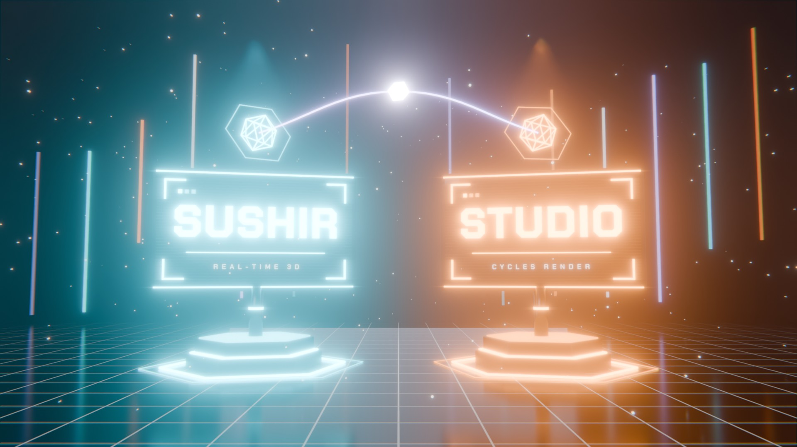
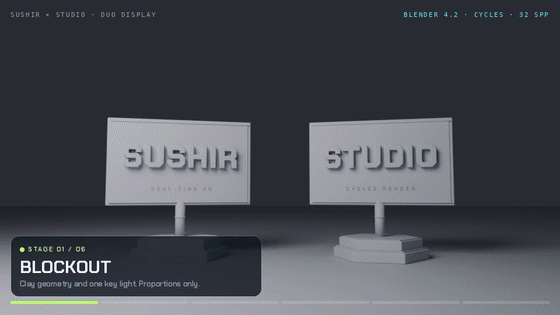
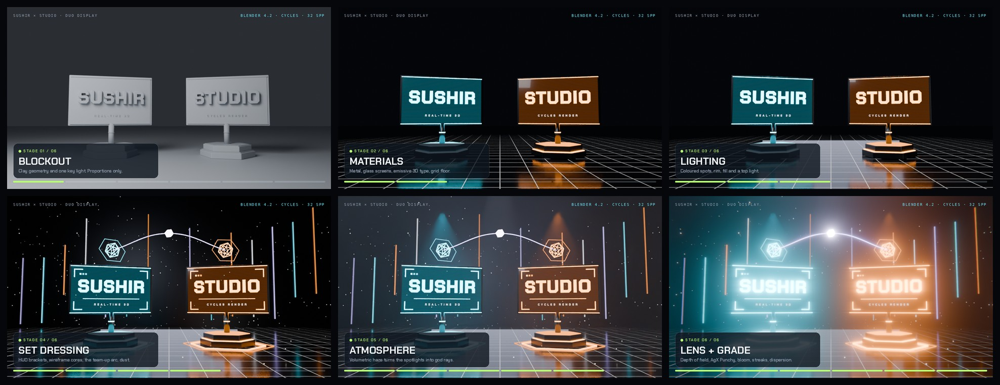
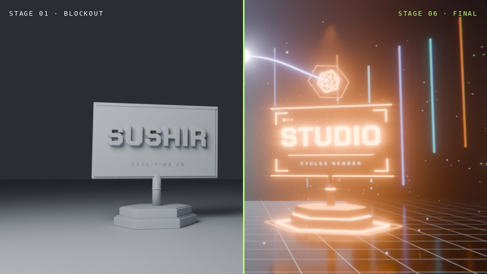
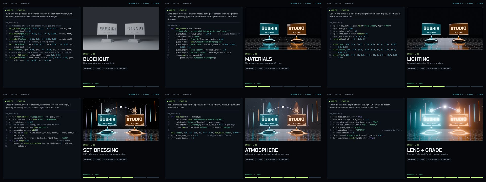

# Duo Display: a Blender build log



Sushir 3D Studio's first path-traced piece. One Python script builds the
whole scene in Blender 4.2 LTS and renders it with Cycles. There's no hand
modelling and no `.blend` to keep in sync, and the two names are command-line
arguments. Every image on this page came out of the scripts in this folder.

| | |
|---|---|
| **Engine** | Blender 4.2 LTS · Cycles path tracing · OpenImageDenoise |
| **Scene** | 100% procedural, built by [`duo_display.py`](duo_display.py) |
| **Grade** | AgX "Punchy", bloom, anamorphic streaks, lens dispersion |
| **Type** | Chakra Petch (SIL Open Font License, in [`fonts/`](fonts/)) |
| **Final** | 1920×1080, 64 samples, about 8 minutes on a 4-core CPU |

## Watch it get built

The same shot rendered six times, one layer of upgrades per stage:



| Stage | Upgrade | What changes | Time at 960×540 |
|---|---|---|---|
| 1 | **Blockout** | Clay geometry and one key light. Proportions only. | 12 s |
| 2 | **Materials** | Brushed metal, glass screens with scanlines, emissive 3D type, a grid floor. | 13 s |
| 3 | **Lighting** | Coloured spots, rim, fill and a top light. | 15 s |
| 4 | **Set dressing** | HUD brackets, wireframe cores, the team-up arc and crystal, light strips, dust. | 33 s |
| 5 | **Atmosphere** | Volumetric haze turns the spotlights into god rays. | 74 s |
| 6 | **Lens + grade** | Depth of field, AgX Punchy, bloom, streaks and dispersion. | 71 s |





## The making-of

[`make_making_of.py`](make_making_of.py) turns the six stage frames into a
23-second video: for each stage, the prompt and the code that adds it type
out on the left while the render builds on the right. Every prompt is in the
[prompt library](../docs/PROMPT_LIBRARY.md).

[](../portfolio/media/duo-display-making-of.mp4)

[Watch the making-of (MP4, 23 s)](../portfolio/media/duo-display-making-of.mp4)

## Why this beats a browser capture

The studio's earlier stills (V11 to V15) are Playwright screenshots of the
WebGL demos. Cycles renders this one by tracing light the way it actually
travels:

- **Real reflections.** The glossy floor mirrors the displays, the strips and
  the haze, from every angle.
- **Volumetric light.** Spotlights scatter through haze, so god rays come from
  the lighting itself instead of a painted overlay.
- **Physical depth of field.** Dust and light strips go out of focus as real
  bokeh.
- **Emissive geometry lights the scene.** The glowing type and frames cast
  coloured light on the metal around them.
- **Filmic grade.** AgX keeps saturated neon from clipping to flat white.

## Render it yourself

### 1. Install what it needs

One script installs [Blender 4.2 LTS](https://www.blender.org/download/lts/4-2/),
Python 3 with Pillow, and ffmpeg. Both skip anything already installed.

Windows (PowerShell), from the repository root. It uses winget:

```powershell
.\blender\setup_windows.ps1
```

macOS (with [Homebrew](https://brew.sh)) or Linux (apt, dnf, pacman or
zypper). Blender is pinned to 4.2.23, checked against blender.org's
published SHA-256 and unpacked into your home folder:

```bash
./blender/setup_unix.sh
```

Each script ends by printing the installed versions and the command to run
next.

### 2. Render

Windows:

```powershell
.\blender\render_build_log.ps1
.\blender\render_build_log.ps1 -Left ALPHA -Right BRAVO
```

macOS or Linux (pass the Blender path the setup script printed):

```bash
BLENDER=~/.local/opt/blender-4.2.23/blender ./blender/render_build_log.sh
BLENDER=~/.local/opt/blender-4.2.23/blender LEFT=ALPHA RIGHT=BRAVO ./blender/render_build_log.sh
```

That renders the six stages, the convergence ladder and the final shots, then
assembles the timelapse and the making-of video. Output lands in
`blender/renders/`, which Git ignores, so names you render there stay on your
machine.

One still, straight from Blender:

```powershell
& "C:\Program Files\Blender Foundation\Blender 4.2\blender.exe" -b --factory-startup `
	--python blender\duo_display.py -- --left ALPHA --right BRAVO `
	--font blender\fonts\ChakraPetch-Bold.ttf --font-sub blender\fonts\ChakraPetch-SemiBold.ttf `
	--shots hero --out blender\renders
```

## Options

| Option | Default | Does |
|---|---|---|
| `--left`, `--right` | `SUSHIR`, `STUDIO` | The two names. Both share one letter height. |
| `--left-sub`, `--right-sub` | `REAL-TIME 3D`, `CYCLES RENDER` | Subtitles under the names. |
| `--left-color`, `--right-color`, `--link-color` | `00E1FF`, `FF8A1F`, `B9A6FF` | Hex colours of each side and the arc. |
| `--shots` | `hero` | Any of `hero`, `left`, `right`, `wide`, comma-separated. |
| `--stage` | `6` | Build stage 1 to 6, as in the table above. |
| `--sample-ladder` | | Comma list such as `1,4,16,64`: renders once per count, no denoiser. |
| `--samples` | `128` | Cycles samples per pixel. |
| `--width`, `--height`, `--percent` | `1920`, `1080`, `100` | Resolution. |
| `--no-volume` | off | Skips the haze, which roughly halves render time. |
| `--save-blend`, `--pack` | | Saves the scene, with fonts packed in, to open in Blender. |

[`assemble_build_log.py`](assemble_build_log.py) turns the stage frames into
the timelapse (MP4 and GIF), the contact sheet, the before/after split and the
convergence animation, with Winding Sky labels on every frame.
[`make_making_of.py`](make_making_of.py) makes the making-of video and its
contact sheet; pass `--times` with per-stage render seconds to show them on
each stage.
