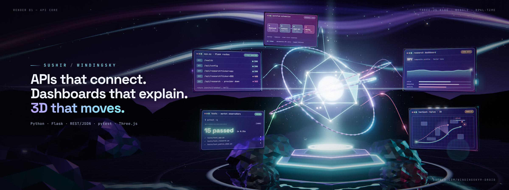

# Showcase

Interactive 3D work by Sushir. Each page is one self-contained HTML file that loads Three.js from jsDelivr, so it runs in any WebGL2 browser with an internet connection.

To preview locally from PowerShell:

```powershell
py -m http.server 4173 --directory showcase
```

Then visit `http://127.0.0.1:4173`.

## Winding Sky — real-time API Core render (latest)

[](SUSHIR_WINDING_SKY_3D_RENDER.html)

[`SUSHIR_WINDING_SKY_3D_RENDER.html`](SUSHIR_WINDING_SKY_3D_RENDER.html) renders the scene in real time. Drag to orbit, scroll to zoom, press <kbd>H</kbd> to hide the interface, and use **Save 4K still** to export a frame.

The glass panels show real facts from Market Observatory: the routes and status codes in `app.py`, each covered by a test, and the actual `pytest -q` result (15 passed). The dashboard and tactical panels are labelled demo data and modeled.

| Media | Format |
| --- | --- |
| [Hero banner](media/sushir-winding-sky-hero.jpg) | 2400 × 900 JPEG |
| [4K still, no type](media/sushir-winding-sky-4k.jpg) | 3840 × 1600 JPEG |
| [Social card](media/sushir-winding-sky-social.jpg) | 1280 × 640 JPEG |
| [Seamless loop](media/sushir-winding-sky-loop.mp4) | 1920 × 1080 MP4, 10 seconds |
| [Animated banner](media/sushir-winding-sky-hero.webp) | 1200 × 450 animated WebP |

Every motion in the scene repeats exactly once every 10 seconds, so the loop is seamless and each frame is a pure function of time. To re-render the media (needs Node.js, ffmpeg, and Playwright's Chromium):

```powershell
npm install --no-save playwright
npx playwright install chromium
node scripts/render_winding_sky.cjs --loops
```

Add `?variant=hero`, `clean`, `social`, or `loop` to the page URL to preview each framing.

## Sushir Halo Tactical Command Center

Tactical values in these demos are modeled, not official Halo telemetry.

- [V12 — Cinematic Operations](SUSHIR_HALO_TACTICAL_COMMAND_CENTER_V12_CINEMATIC_OPERATIONS.html): freeze-frame analysis, cause classification, sector focus, and a story timeline
- [V11 — Director Cut](SUSHIR_HALO_TACTICAL_COMMAND_CENTER_V11_DIRECTOR_CUT.html): full-screen Director Mode with LOS beam, replay ghosts, and decision windows
- [V9 — Showpiece](SUSHIR_HALO_TACTICAL_COMMAND_CENTER_V9_SHOWPIECE.html)
- [V8 — Clarity](SUSHIR_HALO_TACTICAL_COMMAND_CENTER_V8_CLARITY.html)
- [V6](SUSHIR_HALO_TACTICAL_COMMAND_CENTER_V6.html)
